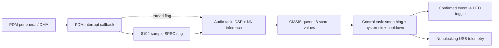

# Real-time keyword spotting on ARM Cortex-M4F

**Zephyr migration:** the default build now targets Arduino Zephyr Boards 1.0.0
using the official packaged toolchain. See [the migration and hardware report](docs/zephyr-port.md)
for setup, memory constraints, validation, and rollback. Use `KWS_CORE=mbed make build`
for the preserved Mbed implementation. The performance tables and architectural
measurements below describe the earlier Mbed firmware unless explicitly stated otherwise.

[](https://github.com/jameslavrenz/KWS_Arm_CortexM4F/actions/workflows/ci.yml)

Continuous single-keyword spotting on an **Arduino Nano 33 BLE / nRF52840**
(64 MHz Cortex-M4F). Interrupt-driven PDM acquisition feeds CMSIS-DSP feature
extraction and an int8 TensorFlow Lite Micro model in a dedicated audio task.
A second task filters queued scores and controls the device. Confirmed **“yes”** detections
toggle the built-in LED. The application runs continuously while powered.

The engineering work covers interrupt/task synchronization, bounded buffering,
CMSIS packed-FFT correctness, int8 inference, and detection filtering across
queue overloads. Two application tasks separate audio processing from device
actions; task separation uses preemption on one core rather than parallel CPUs.
The primary workflow is command-line Make and C++; Arduino IDE is optional.

For a review of the implementation, start with the
[engineering overview](docs/engineering-overview.md): requirements, design
tradeoffs, source entry points, and a mapping from claims to test evidence.
The [RTOS design](docs/rtos-design.md) explains synchronization and failure
behavior; [RTOS validation](docs/rtos-validation.md) records the hardware results.

## Measured results

Measurements below are from the two-task RTOS firmware on the connected Nano,
recorded October 20, 2026. Timing uses the final cumulative normal-operation statistics; the deliberate
stall is documented separately. Memory is from the current C++ firmware build. These are observed results, not worst-case guarantees.

| Measurement | Recorded result |
|---|---:|
| Audio rate / hop | 16 kHz / 256 samples (16 ms) |
| FFT frame / overlap | 512 samples (32 ms) / 50% |
| Model input | 61 × 20 int8 log-mel features (~1 s context) |
| Decision cadence after warmup | Every 8 feature hops (~128 ms), when audio backlog is drained |
| DSP average / observed maximum | 1.987 / 2.129 ms |
| Inference average / observed maximum | 57.655 / 57.772 ms |
| Processing iteration observed maximum | 59.851 ms |
| Circular audio buffer / observed peak occupancy | 8192 / 768 samples |
| Flash / static RAM | 320,088 / 188,392 bytes (32% / 71%) |
| Dedicated task stacks | Audio 8192 bytes; control 6144 bytes |
| RTOS spoken "yes" check | 10 cumulative confirmed actions; physical LED toggling confirmed |
| Reported sample drops / missed buffers / inference errors | 0 / 0 / 0 in the recorded checks |
| Normal-operation score drops / stale results | 0 / 0 |
| Forced 1.5 s control stall | 4 score drops; 9 stale results rejected; 0 reported audio losses |

See [real-time review and validation](docs/realtime-review.md#verification) for current build,
stress, and spoken-word evidence, and [RTOS validation](docs/rtos-validation.md)
for the earlier task checks. The [earlier module/refactor record](docs/module-refactor-validation.md)
and [pre-RTOS build check](docs/build-validation.md) retain historical results.
Response measurements start at a high-confidence window's estimated end; they
do not measure acoustic word-onset latency. Detection accuracy across a controlled
speaker/noise dataset and hours-to-days endurance have not been established.

### Measured memory margins

These high-water measurements come from the current C++ normal and stress
checks. They describe exercised paths, rather than guaranteed worst-case usage.

| Allocation | Capacity | Observed peak use / remaining |
|---|---|---|
| Audio-task stack | 8192 bytes | 1320 used / 6872 unused (84%) |
| Control-task stack | 6144 bytes | 1464 used / 4680 unused (76%) |
| Audio ring | 8192 samples | 768 queued / 7424 spare (91%) |

At peak observed ring occupancy, the remaining capacity represents about 464 ms
of additional audio at 16 kHz. This is buffer capacity, not permission to block
audio processing indefinitely. The eight-score control queue intentionally
overflows in the 1.5 s stall test; dropping scores and rejecting stale evidence
preserves acquisition but can miss a command during the stall.

The static RAM total already includes both application stacks and the 96 KiB
tensor arena. The build leaves 73,752 bytes outside static allocations; this is
not measured free heap. Peak runtime heap, framework/interrupt-stack usage, and
unused tensor-arena capacity have not been measured. Broader memory headroom
must be established before substantial expansion.

## Build, test, and flash

Prerequisites: **Python 3.9+**, GNU Make, and a host C++20 compiler with
AddressSanitizer/UndefinedBehaviorSanitizer support. Supported firmware-build
hosts: macOS Intel/Apple Silicon and Linux x86-64/ARM64. Network access is needed
for initial setup. Apple Silicon also needs Rosetta 2 for the board package's Intel
uploader; its active Arm compiler is native ARM64. No Arduino IDE or globally installed Arduino CLI is required.

```sh
git clone https://github.com/jameslavrenz/KWS_Arm_CortexM4F.git
cd KWS_Arm_CortexM4F
make setup                         # Download and verify pinned tools/libraries
make test                          # Host unit and integration tests
make build                         # Cross-compile for Nano 33 BLE
make boards                        # Find the connected board's serial port
make flash PORT=/dev/cu.usbmodem11201  # Example macOS port; use your board's port
# Linux example: make flash PORT=/dev/ttyACM0
```

`make build` writes ELF/BIN/HEX outputs and a source/dependency manifest to
`.build/artifacts/`. `make flash` rebuilds before uploading. All downloaded tools,
board packages, libraries, generated sketch files, and objects stay under the
ignored `.build/` directory. Existing Arduino IDE libraries are not used.
Use `JOBS=4` to change firmware compile parallelism. A board is needed only for
`make boards`, flashing, and physical tests; host tests and compilation can run
without one. `make help` lists the available targets.

For prerequisite installation, expected output files, serial-port examples,
troubleshooting, and rebuilding the PDF guide, follow the
[complete build guide](docs/build.md).

[dependencies.lock.json](dependencies.lock.json) pins Arduino CLI 1.5.1,
Arduino mbed Nano core 4.6.0, Arm GNU Toolchain 13.3.Rel1 (GCC 13.3.1),
CMSIS-DSP 5.7.0, and
TensorFlow Lite Micro's exact source revision. CLI/library downloads are
SHA-256 checked; Arduino CLI verifies core/tool package downloads. The three
required TFLite compatibility headers are tracked in `build-support/`.
See [build reproducibility](docs/build.md) for dependency provenance and limitations.

GitHub Actions runs **the same `make test` and `make setup && make build` paths**
on pushes and pull requests, plus `make format-check` with pinned formatters.
Firmware and build manifests are retained as CI
artifacts. Physical microphone/LED testing remains a hardware check.

## Source language and formatting

All project-owned firmware and native tests are **C++**, including the minimal
`.ino` entry point and `.h` declarations; there are no project-owned `.c`
translation units. Maintained native code requires **C++20 or later**. Host tests
and the model inspector compile with C++20; the firmware build explicitly selects
GNU++20 and rejects older language modes. Python supplies host tooling/training,
and a shell script runs the tests. The downloaded Arduino/Mbed and CMSIS libraries retain their
upstream C/C++ implementations. Compiled board C++ sources use the selected mode; imported C sources remain C,
and the supplied precompiled Mbed/RTX archive is retained. Arduino IDE builds require the
[same compiler configuration](docs/build.md#c20-compiler-configuration).

Maintained code uses **four spaces per indentation level**, with `.clang-format`,
Black configuration, and `.editorconfig` checked into the repository. Native
includes are grouped and alphabetized, with whitespace between definitions and
logical sections. Makefile recipes retain their required tabs. Run `make format`
to apply the style and
`make format-check` to verify it; the [formatting guide](docs/source-style.md)
documents the project-local formatter setup. Native test fixtures are ordinary
C++ source/header files under `tests/fixtures/`.

## Runtime architecture and ownership



| Module | Owned state and responsibility | Execution context |
|---|---|---|
| `audio_capture` | PDM staging, ring, acquisition counters, complete-hop reads | Interrupt producer; audio-task consumer |
| `audio_pipeline` | Hop processing, readiness, backlog deferral, DSP/inference timing | Audio task |
| `feature_extractor` | Hann/FFT workspace, overlap, quantization, rolling features | Audio task |
| `keyword_model` | Interpreter, 96 KiB tensor arena, class-0 probability | Audio task |
| `keyword_event` / `keyword_detector` | Event freshness, confidence filtering, cooldown, response evidence | Control task |
| `device_control` | Built-in LED state and confirmed-event action | Control task after initialization |
| `telemetry` | Output staging and nonblocking USB transmission | Control task after initialization |
| `kws_pipeline` | Task/queue startup, transport, generations, metrics synchronization | Startup plus two task entry points |
| `kws_config` | Shared dimensions and inference cadence | Compile-time configuration |

Stateful modules use C++ objects: `FeatureExtractor` owns fixed-size DSP buffers,
`AudioCapture` owns the microphone ring and callback context, and `DeviceControl`
and `Telemetry` own their respective state. `AudioPipeline` receives its capture,
extractor, and model dependencies by reference. A private application object owns
the RTOS resources; the single-model `KeywordModel` encapsulates its fixed TFLite
runtime. Fixed-size `AudioHop`/`FeatureTensor` references retain dimensions across
module boundaries. Scoped guards restore interrupt masks and release metrics
locks automatically; resource owners are noncopyable. See the
[C++ idioms and ownership review](docs/cpp-idioms.md).

The `.ino` only delegates startup and idles the existing Arduino main task.
Application behavior lives in `.cpp`/`.h` modules. The Makefile invokes a pinned
Arduino CLI, which configures the Arm cross-compiler and board framework; it
still compiles the minimal `.ino`. This is an IDE-independent build using the
Arduino Mbed core, not a standalone replacement for that framework.
Two application tasks use the board's built-in CMSIS-RTOS2/RTX kernel: audio at
`AboveNormal` priority with an 8 KiB stack, control at `Normal` with a 6 KiB stack.
Stacks, thread control blocks, queue storage, and mutex storage are static.
The callback sets an ISR-safe thread flag after publishing audio. Flags may
coalesce; the audio task drains complete hops before waiting again.

PDM acquisition runs in the interrupt callback, outside both application tasks.
The current firmware actively uses both tasks; they were added to separate
processing and device response and provide room for future functionality. The
present keyword/LED workload could also be implemented with interrupt-driven
capture and a cooperative main loop. This build uses the RTOS architecture;
there is no selectable cooperative application mode. Two application tasks are
sufficient for the current workload; framework/kernel threads also exist.

The queue copies timestamped score values, including low scores needed to rearm
the detector. No audio buffers, feature windows, or tensor pointers cross tasks.
A metrics mutex protects only a short copy; both tasks try it without waiting,
and keep processing if that optional copy is busy. The interrupt callback never
takes that mutex. Audio never waits for room in the event queue. A short scheduler
lock protects the final event check and preinitialized LED write while leaving
interrupts enabled.
See [RTOS design](docs/rtos-design.md) for scheduling, ownership, and overload rules.

## DSP pipeline

The audio task scales signed PCM by `1/32768`, forms 512-sample frames with
256-sample overlap, applies a periodic Hann window, and computes a CMSIS real
FFT. Correct packed-bin handling produces 257 power values. A 20-band mel matrix
(20-4000 Hz) projects the power spectrum; natural log with epsilon `1e-6` and
model-provided int8 quantization produce each feature row. The rolling 61 x 20
input spans 992 ms of audio; inference runs nominally every eight new rows
(128 ms) once ready and caught up.

The [DSP pipeline guide](docs/dsp-pipeline.md) documents stage equations, buffer
dimensions, startup/reset behavior, model layout, and timing boundaries. Full
numerical feature parity with the training notebook has not been established.

## TinyML neural-network inference

The model is an int8 depthwise-separable CNN with input `[1,61,20,1]` and three
softmax outputs: `yes`, unknown speech, and silence. The training model has
**1315 Keras parameters** (1155 trainable); the converted graph contains
**992 int8 weights and 83 int32 biases**, or 1075 parameter values after
batch-normalization folding. Six convolutions, spatial mean pooling, and softmax
form the eight-operator inference graph.

The saved Colab notebook reports **93.48% test accuracy (loss 0.1853)**;
the final training epoch reports **97.90% validation accuracy** and **98.02%
training accuracy** for this small model. These floating-point dataset results
are separate from on-device recognition performance.

**Roughly mid-90% keyword-recognition success during informal
use** with this 1075-parameter deployed model. This is an approximate observation
under current operating conditions; a labeled trial count and false-trigger rate
have not been supplied for the estimate. **An untested hypothesis is that a wider
or deeper model, with suitable training and tuning, could improve recognition
into the upper 90% range.** On-device accuracy also depends on training data,
microphone and noise conditions, preprocessing alignment, quantization, and
detection thresholds. Additional parameters alone do not guarantee improvement;
a controlled comparison must also check false triggers, latency,
and RAM use. See [recognition evidence and hypothesis](docs/tinyml-inference.md#informal-recognition-and-possible-model-expansion).

The **8496-byte model blob and its weights reside in internal flash**, compiled
from the tracked header. Inference reserves a **96 KiB SRAM tensor arena** for
activations/scratch/runtime metadata. The unused operator profiler is disabled;
whole-invocation timing remains in telemetry. These allocations are already
included in the reported firmware memory totals. The [TinyML inference guide](docs/tinyml-inference.md)
documents layer counts, quantization, model identity, storage placement, runtime
flow, inspection commands, and the limits of the recorded training accuracy.

## Real-time behavior and design choices

**Acquisition.** The PDM callback drains bounded reads into a single-producer,
single-consumer circular buffer using lock-free atomic publication. It does no
DSP, inference, GPIO action, or USB printing. The audio task consumes complete
256-sample hops. The 8192-sample capacity provides 512 ms of nominal buffering
at 16 kHz; it absorbs bounded stalls rather than sustained overload.

**Scheduling.** Capture starts after model/DSP initialization. The first decision
waits for a full feature window; subsequent decisions require eight new feature
frames and less than one queued hop. FFT frame overlap continues across model
calls. DSP and inference leave interrupts enabled; short counter snapshots mask
interrupts. With the recorded averages, eight DSP hops plus one inference take
about 74 ms of a nominal 128 ms decision interval, excluding other work.

**FFT correctness.** CMSIS fast real FFT packs DC at output index 0 and Nyquist at
index 1. `fft_power.h` treats both separately and computes interior-bin power
without reading beyond the 512-float output. Tests exercise exact-size arrays
under address/undefined-behavior sanitizers.

**Detection.** Class 0 is `yes`; the training labels also include unknown speech
and silence. A confidence EMA with weight 0.5 must reach 0.75 while raw confidence
is at least 0.8 on two successive decisions. The filter rearms below 0.4 and
requires 1500 ms between triggers. Thresholds are starting values for broader
speech/noise validation, rather than an established false-positive guarantee.

**Failure behavior.** A full ring rejects new samples, counts dropped samples
and affected callbacks, and preserves unread samples. On observing a loss, the
audio task discards pending audio, resets features, invalidates older queued
scores, and waits for a fresh feature window. Failed inference increments an
error counter and invalidates detection evidence. A full event queue drops a
score and advances a generation counter rather than blocking audio. The control
task rejects old generations and scores older than 250 ms; sequence/cadence gaps
reset temporal evidence while retaining latch/cooldown history. Startup checks
DSP/model/PDM and RTOS objects/tasks, cleaning up tasks on partial failure. Automatic recovery from
peripheral failure is future work.

## Tests and instrumentation

`make test-unit` runs eleven component checks. `make test-regression`
runs the complete fifteen-check suite, including those unit tests plus stream,
pipeline, RTOS startup, and build-tool checks. `make test` runs the same complete
regression gate in CI. Compile-contract probes also verify that invalid buffer
extents and ownership copies are rejected. See the [testing guide](docs/testing.md) for coverage,
commands, hardware procedures, and limits.

The suite exercises queue ordering/overflow/wraparound, packed FFT bins/bounds,
simulated inference stalls, temporal filtering and cooldown, detection-response
timing and timer wraparound, actual GPIO-module logic with fake pins, and the actual
audio pipeline with fake capture/features/model modules. New checks exercise the actual
extractor against frozen periodic-Hann feature vectors and the actual PDM receiver
against a deterministic driver fake. RTOS startup tests
check static storage, priority/stack configuration, callback notification, and
cleanup after initialization failures. Event tests cover stale generations,
queue gaps, duplicate scores, timestamp wraparound, and cooldown retention. Build-tool tests check archive
checksums, extraction boundaries, library/lock drift, and environment isolation.

At 115200 baud, USB telemetry is emitted every two seconds without waiting for a
host. A two-second startup timeout allows standalone operation.

| Field | Meaning |
|---|---|
| `samples`, `dropped`, `missed_buffers` | Received sample count; ring loss; callbacks with loss |
| `queue_max`, `gap_max_us`, `audio_age_us` | Peak backlog; maximum callback gap; time since last callback |
| `dsp_us`, `infer_us`, `process_us` | Average/maximum execution times in microseconds |
| `response_us` | Last/maximum estimated high-confidence-window-to-action delay |
| `inferences`, `errors`, `p_milli` | Model calls, failures, class-0 confidence × 1000 |
| `triggers`, `led` | Confirmed actions and current logical LED state |
| `event_drops`, `stale_events`, `notify_errors` | Nonblocking queue send failures, discarded stale scores, ISR flag errors |
| `event_us` | Average/maximum inference-result transport delay |
| `stack_free` | Minimum unused stack bytes: audio/control, from the RTX watermark |

For a live capture, install `pyserial` in a host virtual environment and run:

```sh
python3 tests/hardware_capture.py --port /dev/cu.usbmodem11201 --seconds 60
```

Say “yes” with pauses of about three seconds and observe the LED. The script
checks acquisition/inference progression and reported loss/error counters;
physical LED behavior and speech-trigger correspondence require observation.
The host recording ends after the requested interval; firmware keeps running.

## Model and project artifacts

- [Training notebook](training/kws_1class_depthwise.ipynb): Google Speech Commands training and quantization workflow.
- [Model architecture](kws_1class_depthwise_int8.tflite.png): exported model visualization.
- [Feature timing diagram](1sec_timing.png): context and overlap illustration.
- [Documentation index](docs/README.md): initial and refactor validation records with raw telemetry.
- [Engineering overview](docs/engineering-overview.md): design decisions, source navigation, and evidence for reviewers.

## Next engineering work

Evaluate false accepts/rejects across speakers, noise, distance, and silence;
run longer endurance tests; measure runtime heap, framework/interrupt stacks,
and tensor-arena usage; add peripheral fault recovery; and extend the control
task with communications or additional device functionality. Threshold
refinement and multi-keyword training are separate from the build/runtime work.

The [real-time execution review](docs/realtime-review.md) records the runtime
hardening, tested properties, and remaining platform/startup/fault-handling limits.
The observed checks do not establish hard real-time or functional-safety certification.
