# Real-time keyword spotting on ARM Cortex-M4F

[](https://github.com/NetKit-Labs/KWS_Arm_CortexM4F/actions/workflows/ci.yml)

Continuous voice control on an **Arduino Nano 33 BLE Sense / nRF52840**, running
**Arduino Zephyr Boards 1.0.0**. The microphone captures mono audio at 16 kHz,
CMSIS-DSP extracts log-mel features, and an int8 TensorFlow Lite Micro model
scores the keyword **“yes.”** Confirmed detections toggle the built-in LED.
The application runs continuously while powered, independently of a serial monitor.

Zephyr is the sole build target. Two C++ application threads separate audio
processing from device control. The core's PDM thread acquires samples; it can
preempt inference, preserving acquisition while the audio thread spends roughly
55 ms on a model invocation. All threads share one 64 MHz Cortex-M4F CPU.

## Build, test, and upload

Requirements: Git, Make, Python 3.9+, HTTPS access for setup, and a host `c++`
compiler with C++20 and AddressSanitizer/UndefinedBehaviorSanitizer support.
macOS Command Line Tools and Ubuntu 24.04 are suitable host environments.
The cross-compiler is installed by Arduino CLI, not supplied by the host compiler.

```sh
make setup                         # Install locked tools and libraries locally
make test-unit                     # Isolated component tests
make test-regression               # Units plus integration and build-tool checks
make build JOBS=4                  # Compile for Zephyr
make boards                        # Find the connected Nano
make flash PORT=/dev/cu.usbmodem11301 JOBS=4
```

Substitute your actual USB port; Linux commonly uses `/dev/ttyACM0`. Close any
other serial monitor before uploading. Arduino CLI installs/updates the official
Zephyr loader automatically. Double-press RESET if bootloader recovery is needed.
On Apple Silicon, the packaged Intel uploader requires Rosetta 2.

All tools, downloads, libraries, staged sources, objects, and binaries stay under
ignored `.build/`. Existing global Arduino installations are not used. Edit
`firmware/`, never the generated sketch. Outputs and their exact input manifest
are in `.build/zephyr-artifacts/`. The selected FQBN is
`arduino:zephyr_main:nano33ble:link_mode=static`.

The locked inputs are Arduino CLI 1.5.1, Arduino Zephyr Boards 1.0.0, its official
`arm-zephyr-eabi@1.0.1` compiler (GCC 14.3.0), Arduino_CMSIS-DSP 5.7.0,
and the exact TensorFlow Lite source revision recorded in
[dependencies.lock.json](dependencies.lock.json). Firmware and host tests use
C++20. See [build and CI](docs/build.md) for provenance, prerequisites, optional
IDE settings, troubleshooting, and PDF generation.

## Runtime architecture and ownership

```mermaid
flowchart LR
    MIC["16 kHz PDM microphone"] --> PDM["Core PDM thread: priority 3"]
    PDM --> RING["8192-sample SPSC ring"]
    PDM -. "binary semaphore" .-> AUDIO["Audio thread: priority 4"]
    RING --> AUDIO
    AUDIO --> FEATURES["512-point FFT / 20 log-mel bands"]
    FEATURES --> MODEL["61 x 20 int8 context / inference"]
    MODEL --> EVENTS["Zephyr queue: 8 score values"]
    EVENTS --> CONTROL["Control thread: priority 5"]
    CONTROL --> LED["Freshness / confidence filter / LED"]
    CONTROL -. "metrics copy" .-> MAIN["Main thread: priority 6"]
    AUDIO -. "metrics copy" .-> MAIN
    MAIN --> USB["Best-effort USB telemetry"]
```



Lower Zephyr priority numbers run first. The audio thread owns feature extraction,
the model, and stream recovery. Control owns temporal detection and the LED.
The lower-priority main thread owns telemetry, isolating internal Serial waits
from keyword control. A queue copies score/timestamp/sequence/generation values, never
pointers into shared audio or tensor buffers. A delayed control thread can lose
scores without blocking the audio consumer. An overflowing audio ring rejects
new samples and explicitly resets detection evidence.

| Module | Responsibility |
| --- | --- |
| `kws_pipeline` | Zephyr threads, fixed stacks, semaphore, score queue, metrics mutex, initialization and cleanup |
| `audio_capture` / `audio_queue` | PDM callback routing, bounded reads, lock-free sample publication, complete-hop reads and loss counters |
| `audio_pipeline` | DSP readiness, backlog-aware inference, generation reset and timing |
| `feature_extractor` / `fft_power` | PCM scaling, frame overlap, periodic Hann, packed real FFT, power, mel/log and int8 features |
| `keyword_model` | Single interpreter, four operator types, fixed 64 KiB tensor arena and score decoding |
| `keyword_event` / `keyword_filter` | Freshness, sequence continuity, confidence smoothing, hysteresis and cooldown |
| `device_control` / `telemetry` | LED action and separate best-effort diagnostic output |

The application and model runtime have static lifetime. Fixed application
stacks reserve 8192 bytes for audio and 6144 for control. A nonblocking mutex
protects only short metrics copies. Zephyr IRQ keys preserve nested capture
snapshots; scheduler locking covers the final freshness check and initialized
GPIO write while leaving interrupts enabled. See [RTOS design](docs/rtos-design.md)
and [C++ ownership](docs/cpp-idioms.md). Application buffers and kernel resources
use fixed storage, including the inference arena. The build rejects direct heap
allocation/deallocation imports in sketch objects, disables exceptions/RTTI and
rejects variable-length arrays. Each audio activation handles at most eight hops;
a full batch yields for 1 ms before resuming. These controls do not establish a
whole-system WCET or prove that loader/driver code never allocates.

## Features, model, and detection

Each 256-sample hop advances a 512-sample frame with 50% overlap. The extractor
uses a periodic Hann window, 257 correctly unpacked FFT power bins, a 20-band
mel matrix spanning 20-4000 Hz, natural log with epsilon 1e-6, and model-supplied
int8 quantization. The 61-row context covers 992 ms of audio. First inference
requires a full context; subsequent attempts require eight new rows and a drained
hop backlog, giving a nominal 128 ms decision interval.

The deployed 8496-byte model classifies `yes`, unknown speech, and silence. Its
six convolution operators contain 992 int8 weights and 83 int32 biases:
**1075 deployed parameter values**, or 1324 parameter payload bytes. Its eight
operators use Conv2D, DepthwiseConv2D, MEAN and SOFTMAX registrations. The model
and mel coefficients are compiled into flash; the 64 KiB arena holds mutable
inference data. Startup reports actual tensor allocation.

Control uses class-0 confidence, EMA weight 0.5, raw/smoothed thresholds 0.8/0.75,
two qualifying decisions, release below 0.4, and a 1500 ms cooldown. Events expire
after 250 ms; sequence/generation gaps discard partial evidence while retaining
latch and cooldown state. A final scheduler-locked check prevents an obsolete
score from triggering an action after audio invalidates its generation.

See [DSP details](docs/dsp-pipeline.md) for formulas, packed FFT layout and training
alignment, and [TinyML inference](docs/tinyml-inference.md) for the exact model
graph, quantization, training results, inspection commands and accuracy limits.

## Measured Zephyr results

The following observations come from the October 22, 2026 Zephyr hardware
session. They describe the recorded image and workload, not worst-case guarantees.
The cleanup build and any new measurements are identified separately in
[validation](docs/validation.md).

| Measurement | Recorded result |
| --- | --- |
| Sampling rate over normal capture | Approximately 15,999.7 samples/second |
| Normal DSP average / observed maximum | 2.217 / 5.249 ms per consumed hop |
| Normal inference average / observed maximum | 54.994 / 55.054 ms |
| Normal processing-step maximum | 57.342 ms |
| Audio-ring high-water mark | 768 of 8192 samples |
| Normal losses and errors | Zero reported sample losses, missed buffers, inference errors, notification errors, event drops or stale events |
| Spoken keyword check | 16 cumulative confirmed actions; user confirmed physical LED toggling on “yes” |
| Deliberate 1500 ms control stall | Four expected event drops, nine stale scores rejected, no reported audio loss or inference errors |
| Recorded sketch flash / RAM | 206,032 / 118,096 bytes |
| Stock loader sketch RAM region | 131,072 bytes; recorded remainder 12,976 bytes |
| Tensor arena reserved / measured used | 65,536 / 12,500 bytes |

The RAM figure already includes both application stacks, ring, DSP workspace,
and reserved arena. The remainder is not measured free heap. Stock loader stack
watermarks are unavailable: `stack_free=0/0` means unmeasured. General system heap,
framework/interrupt stacks, extended endurance, cold power-cycle, and calibrated
acoustic accuracy remain separate validation work. See [real-time limits](docs/realtime-review.md).

The table preserves the original image's evidence. The later C++20 hardening
build uses 206,808 bytes flash; normal, control-stall and restored-image checks
passed with the new runtime. [Current validation](docs/validation.md#c20-real-time-hardening-validation)
records its source hashes, captures and limits; speech/LED was not repeated.

The saved training notebook reports 93.48% floating-point held-out test accuracy,
97.90% validation accuracy, and 98.02% final training accuracy. These are training
artifacts, not measured recognition rates for the quantized model on this board.
Speech/LED checks establish functionality without an accuracy denominator.

## Hardware checks and telemetry

Install PySerial in a local environment, then capture normal operation:

```sh
python3 -m venv .build/hardware-venv
.build/hardware-venv/bin/python -m pip install pyserial==3.5
.build/hardware-venv/bin/python tests/hardware_capture.py --port /dev/cu.usbmodem11301 \
    --seconds 60 --allow-unavailable-stack-metrics --output .build/normal.json
.build/hardware-venv/bin/python scripts/rtos_stress.py --port /dev/cu.usbmodem11301 \
    --seconds 25 --output .build/stress.json
```

The stress script uploads a test-only control-stall image and restores the normal
image in `finally`; confirm restoration succeeds. Speak “yes” with pauses and
observe the LED separately. Ending a capture leaves the firmware running.

| Telemetry field | Meaning |
| --- | --- |
| `ms`, `samples` | Uptime and cumulative samples received by the callback |
| `dropped`, `missed_buffers` | Rejected ring samples and callbacks with lost/invalid reads |
| `queue_max`, `gap_max_us`, `audio_age_us` | Ring high-water mark, maximum callback gap, age of last received audio |
| `dsp_us`, `infer_us`, `process_us` | Average / observed maximum DSP, inference and one pipeline step |
| `response_us` | Last / maximum response from estimated first high-confidence window end to action; not acoustic-onset latency |
| `inferences`, `errors`, `dsp_errors`, `p_milli` | Invocation count, inference/DSP failures and latest class-0 score scaled by 1000 |
| `triggers`, `led` | Confirmed action count and logical LED state |
| `event_drops`, `stale_events` | Dropped classification results and rejected expired/old-generation results |
| `notify_errors` | Reserved diagnostic counter; Zephyr binary-semaphore give has no failure return |
| `event_us` | Average / maximum inference-completion to control-validation delay |
| `stack_free` | Audio/control unused stack bytes if loader support exists; stock loader reports zero/zero |

Counters are cumulative and may precede a host recording. Compare successive
records to infer activity within an interval. A buffered telemetry line may
precede the fresh lines received when reopening a monitor.

## Tests and documentation

`make test` runs the same complete host gate as GitHub Actions. The unit and
regression suites exercise actual Zephyr application modules with deterministic
PDM, IRQ, serial, DSP, model and kernel fixtures. Hardware checks cover the real
microphone/DSP/model path. [Testing](docs/testing.md) describes coverage and limits.

[Documentation index](docs/README.md) links setup, architecture, DSP, inference,
ownership, real-time behavior and validation evidence. [README.pdf](docs/README.pdf)
is the exported version of this guide. Model assets and the training notebook
remain available under `models/` and `training/`.
