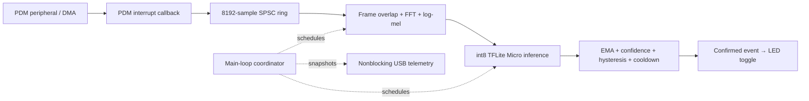

# Real-time keyword spotting on ARM Cortex-M4F

[](https://github.com/jameslavrenz/KWS_Arm_CortexM4F/actions/workflows/ci.yml)

Continuous single-keyword spotting on an **Arduino Nano 33 BLE / nRF52840**
(64 MHz Cortex-M4F). Interrupt-driven PDM acquisition feeds CMSIS-DSP feature
extraction and an int8 TensorFlow Lite Micro model. Confirmed **“yes”** detections
toggle the built-in LED. The application runs continuously while powered.

The implementation focuses on bounded buffering, preserved sample/frame order,
measured execution time, explicit module ownership, and tested failure paths.
The primary workflow is command-line Make and C++; Arduino IDE is optional.

## Measured results

Measurements below are from the refactored firmware on the connected Nano,
recorded October 20, 2026. Timing summarizes the recorded checks; memory is from
the locked CLI build. These are observed results, not worst-case guarantees.

| Measurement | Recorded result |
|---|---:|
| Audio rate / hop | 16 kHz / 256 samples (16 ms) |
| FFT frame / overlap | 512 samples (32 ms) / 50% |
| Model input | 61 × 20 int8 log-mel features (~1 s context) |
| Decision cadence after warmup | Every 8 feature hops (~128 ms), when audio backlog is drained |
| DSP average / observed maximum | 2.48 / 3.04 ms |
| Inference average / observed maximum | 59.09 / 60.10 ms |
| Processing iteration observed maximum | 62.87 ms |
| Circular audio buffer / observed peak occupancy | 8192 / 768 samples |
| Flash / static RAM | 328,880 / 194,112 bytes (33% / 74%) |
| 60-second spoken “yes” check | 12 confirmed detections; physical LED toggling confirmed |
| Reported sample drops / missed buffers / inference errors | 0 / 0 / 0 in the recorded checks |

See [speech/refactor validation](docs/module-refactor-validation.md) and the
[locked-build check](docs/build-validation.md). Response
measurements start at a high-confidence window's estimated end; they do not
measure acoustic word-onset latency. Detection accuracy across a controlled
speaker/noise dataset and hours-to-days endurance have not been established.

## Build, test, and flash

Prerequisites: **Python 3.9+**, GNU Make, and a host C++ compiler with
AddressSanitizer/UndefinedBehaviorSanitizer support. Supported firmware-build
hosts: macOS Intel/Apple Silicon and Linux x86-64/ARM64. Network access is needed
for initial setup. Apple Silicon also needs Rosetta 2 for the pinned Intel
Arm compiler. No Arduino IDE or globally installed Arduino CLI is required.

```sh
git clone https://github.com/jameslavrenz/KWS_Arm_CortexM4F.git
cd KWS_Arm_CortexM4F
make setup                         # Download and verify pinned tools/libraries
make test                          # Host unit and integration tests
make build                         # Cross-compile for Nano 33 BLE
make boards                        # Find the connected board's serial port
make flash PORT=/dev/cu.usbmodem11201  # Example macOS port; use your board's port
# Linux example: make flash PORT=/dev/ttyACM0
```

`make build` writes ELF/BIN/HEX outputs and a source/dependency manifest to
`.build/artifacts/`. `make flash` rebuilds before uploading. All downloaded tools,
board packages, libraries, generated sketch files, and objects stay under the
ignored `.build/` directory. Existing Arduino IDE libraries are not used.
Use `JOBS=4` to change firmware compile parallelism. A board is needed only for
`make boards`, flashing, and physical tests; host tests and compilation can run
without one. `make help` lists the available targets.

For prerequisite installation, expected output files, serial-port examples,
troubleshooting, and rebuilding the PDF guide, follow the
[complete build guide](docs/build.md).

[dependencies.lock.json](dependencies.lock.json) pins Arduino CLI 1.5.1,
Arduino mbed Nano core 4.6.0 (GCC Arm Embedded 7-2017q4), CMSIS-DSP 5.7.0, and
TensorFlow Lite Micro's exact source revision. CLI/library downloads are
SHA-256 checked; Arduino CLI verifies core/tool package downloads. The three
required TFLite compatibility headers are tracked in `build-support/`.
See [build reproducibility](docs/build.md) for dependency provenance and limitations.

GitHub Actions runs **the same `make test` and `make setup && make build` paths**
on pushes and pull requests. Firmware and build manifests are retained as CI
artifacts. Physical microphone/LED testing remains a hardware check.

## Runtime architecture and ownership



| Module | Owned state and responsibility | Execution context |
|---|---|---|
| `audio_capture` | PDM staging, ring, acquisition counters, complete-hop reads | Interrupt producer; main-loop consumer |
| `feature_extractor` | Hann/FFT workspace, overlap, quantization, rolling features, readiness | Main loop |
| `keyword_model` | Interpreter, 96 KiB tensor arena, tensor validation, class-0 probability | Main loop |
| `keyword_detector` | Confidence filter, rearming/cooldown, response evidence | Main loop; hardware independent |
| `device_control` | Built-in LED state and confirmed-event action | Main loop |
| `telemetry` | Output staging and nonblocking USB transmission | Main loop |
| `kws_pipeline` | Scheduling, overflow recovery, timing and event routing | Main loop |
| `kws_config` | Shared dimensions and inference cadence | Compile-time configuration |

The `.ino` contains only `setup()`/`loop()` delegation. Application code is in
`.cpp`/`.h` modules. The board's Arduino mbed core supplies the underlying RTOS;
this application creates no separate tasks. The modules currently have one
main-loop owner. A future task split needs explicit queue/snapshot lifetimes and
synchronization; it cannot call these stateful APIs concurrently without changes.

## Real-time behavior and design choices

**Acquisition.** The PDM callback drains bounded reads into a single-producer,
single-consumer circular buffer using lock-free atomic publication. It does no
DSP, inference, GPIO action, or USB printing. The main loop consumes complete
256-sample hops. The 8192-sample capacity provides 512 ms of nominal buffering
at 16 kHz; it absorbs bounded stalls rather than sustained overload.

**Scheduling.** Capture starts after model/DSP initialization. The first decision
waits for a full feature window; subsequent decisions require eight new feature
frames and less than one queued hop. FFT frame overlap continues across model
calls. DSP and inference leave interrupts enabled; short counter snapshots mask
interrupts. With the recorded averages, eight DSP hops plus one inference take
about 79 ms of a nominal 128 ms decision interval, excluding other work.

**FFT correctness.** CMSIS fast real FFT packs DC at output index 0 and Nyquist at
index 1. `fft_power.h` treats both separately and computes interior-bin power
without reading beyond the 512-float output. Tests exercise exact-size arrays
under address/undefined-behavior sanitizers.

**Detection.** Class 0 is `yes`; the training labels also include unknown speech
and silence. A confidence EMA with weight 0.5 must reach 0.75 while raw confidence
is at least 0.8 on two successive decisions. The filter rearms below 0.4 and
requires 1500 ms between triggers. Thresholds are starting values for broader
speech/noise validation, rather than an established false-positive guarantee.

**Failure behavior.** A full ring rejects new samples, counts dropped samples
and affected callbacks, and preserves unread samples. On observing a loss, the
coordinator discards pending audio, resets feature/detection state, and waits for
a fresh feature window. Failed inference increments an error counter and resets
detection state. Startup validates FFT initialization, tensor type/size/scales,
and PDM startup; failures are reported and halt setup. Automatic recovery from
peripheral failure is future work.

## Tests and instrumentation

`make test` exercises queue ordering/overflow/wraparound, packed FFT bins/bounds,
simulated inference stalls, temporal filtering and cooldown, detection-response
timing and timer wraparound, actual GPIO-module logic with fake pins, and actual
coordinator logic with fake capture/model/telemetry modules. Pipeline tests cover
startup failures, readiness, backlog deferral, confirmed actions, inference
errors, overflow reset, and statistics routing. Build-tool tests check archive
checksums, extraction boundaries, library/lock drift, and environment isolation.

At 115200 baud, USB telemetry is emitted every two seconds without waiting for a
host. A two-second startup timeout allows standalone operation.

| Field | Meaning |
|---|---|
| `samples`, `dropped`, `missed_buffers` | Received sample count; ring loss; callbacks with loss |
| `queue_max`, `gap_max_us`, `audio_age_us` | Peak backlog; maximum callback gap; time since last callback |
| `dsp_us`, `infer_us`, `process_us` | Average/maximum execution times in microseconds |
| `response_us` | Last/maximum estimated high-confidence-window-to-action delay |
| `inferences`, `errors`, `p_milli` | Model calls, failures, class-0 confidence × 1000 |
| `triggers`, `led` | Confirmed actions and current logical LED state |

For a live capture, install `pyserial` in a host virtual environment and run:

```sh
python3 tests/hardware_capture.py --port /dev/cu.usbmodem11201 --seconds 60
```

Say “yes” with pauses of about three seconds and observe the LED. The script
checks acquisition/inference progression and reported loss/error counters;
physical LED behavior and speech-trigger correspondence require observation.
The host recording ends after the requested interval; firmware keeps running.

## Model and project artifacts

- [Training notebook](training/kws_1class_depthwise.ipynb): Google Speech Commands training and quantization workflow.
- [Model architecture](kws_1class_depthwise_int8.tflite.png): exported model visualization.
- [Feature timing diagram](1sec_timing.png): context and overlap illustration.
- [Documentation index](docs/README.md): initial and refactor validation records with raw telemetry.

## Next engineering work

Evaluate false accepts/rejects across speakers, noise, distance, and silence;
run longer endurance tests; add peripheral fault recovery; and introduce explicit
RTOS tasks when expansion provides a useful concurrent workload. Threshold
refinement and multi-keyword training are separate from the build/runtime work.
