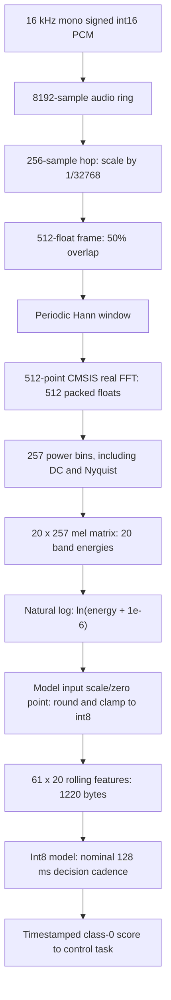

# DSP and model-input pipeline

This document describes the maintained firmware in
[feature_extractor.cpp](../firmware/feature_extractor.cpp),
[fft_power.h](../firmware/fft_power.h), and
[audio_pipeline.cpp](../firmware/audio_pipeline.cpp). All feature extraction and
model access execute in the audio task. Capture-to-DSP input is a fixed-size
`AudioHop` reference; DSP-to-model input is a const `FeatureTensor` reference.
The FFT power helper also enforces its input/output extents at compile time. The PDM interrupt only acquires samples
and wakes that task; the control task receives classification scores.

## Signal flow and dimensions



The constants are defined in [kws_config.h](../firmware/kws_config.h).

| Quantity | Value and meaning |
|---|---|
| Sample rate | 16,000 samples/s; microphone output is mono |
| Hop | 256 new samples, or 16 ms |
| FFT frame | 512 samples, or 32 ms; 256 samples shared with the next frame |
| FFT-bin spacing | 16,000 / 512 = 31.25 Hz |
| One-sided power spectrum | 257 floats, bins 0 through 256; Nyquist is 8 kHz |
| Mel projection | 20 bands, exported for 20-4000 Hz, using a 20 x 257 coefficient matrix |
| Model context | 61 rows x 20 bands, oldest row first; 1220 int8 bytes |
| Context audio span | 512 + 60 x 256 = 15,872 samples, or 992 ms |
| Inference interval | At least eight new feature rows, nominally 128 ms after warmup; backlog can defer inference |

## 1. Capture, scaling, and overlapped frames

[audio_capture.cpp](../firmware/audio_capture.cpp) configures the PDM microphone
for one channel at 16 kHz and sets the driver gain to 60. The driver supplies
signed 16-bit PCM; PDM decimation is handled below the feature extractor. An
interrupt producer writes the SPSC audio ring, and the audio task reads complete
256-sample hops into its private hop buffer.

Each sample is converted to float with `sample / 32768.0f`, giving a range from
`-1.0` to `32767/32768`. This is fixed amplitude scaling; no per-window amplitude
normalization, pre-emphasis, adaptive noise cancellation, or feature
standardization is applied by this module.

The first hop after startup/reset primes the second half of `audioFrame`; it
does not produce a feature row. On each later hop, the previous second half moves
to the first half and the new 256 samples fill the second half. The first FFT
therefore sees two complete real-audio hops, not a zero-padded startup frame.

```text
Feature row 0: samples     0..511
Feature row 1: samples   256..767
Feature row 2: samples   512..1023
...
Feature row 60: samples 15360..15871
```

This is 50% frame overlap. Once primed, one new feature row is generated per
consumed hop, even while the audio task catches up after inference.

## 2. Hann window and real FFT

Initialization precomputes the periodic Hann window used by the training notebook:

```text
w[n] = 0.5 - 0.5 * cos(2*pi*n / 512), n = 0..511
windowed[n] = audioFrame[n] * w[n]
```

`arm_mult_f32` applies the window, followed by a forward
`arm_rfft_fast_f32` with length 512. The output occupies 512 floats in the CMSIS
packed real-FFT layout. It is not a conventional array of 257 complex pairs.

| Frequency bin | Packed representation | Power calculation |
|---|---|---|
| DC, k = 0 | `fftOutput[0]` | `fftOutput[0]^2` |
| Interior, k = 1..255 | Real `fftOutput[2*k]`, imaginary `fftOutput[2*k+1]` | Real squared plus imaginary squared |
| Nyquist, k = 256 | `fftOutput[1]` | `fftOutput[1]^2` |

The final interior bin reads indices 510 and 511. The separate Nyquist case
avoids reading indices 512/513 outside the transform output. `fftPower` writes
exactly 257 power values. The workspace named `powerSpectrum` contains squared magnitudes
(power), not square-root magnitudes. The firmware applies no explicit division
by FFT length, one-sided interior-bin doubling, or window-energy correction.

## 3. Mel projection and logarithm

[mel_filter_coefs.h](../firmware/mel_filter_coefs.h) contains the constant,
nonnegative `melFilterbank[20][257]` matrix. The
[training notebook](../training/kws_1class_depthwise.ipynb) generates the filters
with `tf.signal.linear_to_mel_weight_matrix` using 20 bands, a 16 kHz sample rate,
and lower/upper edges of 20/4000 Hz. Its 257 x 20 result is transposed for the
firmware's matrix multiplication and printed to six decimal places. The tracked
5140 coefficients match that saved notebook output.

`arm_mat_mult_f32` computes:

```text
melEnergy[m] = sum(melFilterbank[m][k] * power[k], k=0..256)
logMel[m] = ln(melEnergy[m] + 0.000001), m=0..19
```

All 257 power bins participate in the matrix shape, but the exported filters
have zero weights outside their support, including DC and the bins at/above
4 kHz. A zero-energy band maps to approximately `-13.81551` before quantization.
The logarithm is natural log; there is no decibel conversion or DCT. The model
uses log-mel features, not MFCCs.

## 4. Int8 quantization and model layout

[keyword_model.cpp](../firmware/keyword_model.cpp) reads the model input scale
and zero point after tensor allocation and passes them to `FeatureExtractor::begin`.
For each band, the firmware uses:

```text
q = roundf(logMel / input_scale + input_zero_point)
q = clamp(q, -128, 127)
```

`roundf` rounds halfway cases away from zero. Scale/zero point are model metadata,
not hardcoded signal-processing constants. Initialization rejects nonpositive
scales and verifies int8 input/output types and the expected 1220 input bytes.

Each 20-byte quantized row is appended to `featureBuffer`; the oldest row is
removed by shifting the prior 60 rows. Time is the major dimension, with ascending
mel-band index within each row: `featureBuffer[frame * 20 + band]`. This matches
the notebook's 61 x 20 x 1 feature layout, with a batch dimension added by the
model. The firmware validates input byte count, not every tensor dimension.

Inference copies the contiguous 1220 bytes into the input tensor and invokes
TensorFlow Lite Micro. Class-0 confidence is decoded as
`output_scale * (output_int8[0] - output_zero_point)`. The label mapping in the
notebook is `yes`, unknown speech, and silence; class 0 supplies the score used
by the control-task filter.
The [TinyML inference guide](tinyml-inference.md) provides the exact deployed
layer graph, parameter counts, input/output quantization, and storage placement.

## 5. Warmup, inference cadence, and discontinuities

The first decision needs 61 valid feature rows, which require 62 captured hops
including the priming hop. That is 992 ms of input audio; wall-clock startup also
includes initialization, scheduling, and inference time. No model call uses a
partially filled feature matrix.

After a model attempt, `markInferred` resets the count of new feature rows. At
least eight additional rows must arrive before the next attempt. Inference is
also deferred until fewer than 256 samples remain queued, giving audio catch-up
priority. Frame overlap and the rolling feature context persist across calls;
the entire 61-row context is not rebuilt from scratch for every decision.

If the ring reports sample loss, the audio task discards pending samples and
resets the overlap/readiness counters. The next hop primes a new frame; 61 new
rows must replace the old feature contents before inference resumes. The reset
does not immediately zero the feature matrix, but the readiness gate prevents
old rows from being used. The RTOS coordinator also advances the generation so
older queued scores cannot become command evidence.

A failed model invocation invalidates detection evidence and increments its
error counter; it does not reset DSP overlap/context. A full score queue also
invalidates old evidence without blocking audio. See
[RTOS design](rtos-design.md#events-and-overload) for the control-side rules.

## Workspace and measured execution time

Feature-extraction arrays are fixed-size `std::array` members of `FeatureExtractor`.
The application owns the extractor with static lifetime; only the audio task
changes it after startup. Copy/move is disabled because CMSIS descriptors point
into the object. No workspace is allocated on the task stack or application heap:

| Workspace | Allocation |
|---|---:|
| `audioFrame`, `windowed`, `hannWindow`, `fftOutput` | Four x 512 floats = 8192 bytes |
| `powerSpectrum` | 257 floats = 1028 bytes |
| `melRow` | 20 floats = 80 bytes |
| `quantizedMelRow` | 20 int8 values = 20 bytes |
| `featureBuffer` | 61 x 20 int8 values = 1220 bytes |
| Array subtotal | 10,540 bytes |

This subtotal excludes FFT/matrix descriptors, counters, coefficient storage,
the audio ring/hop buffer, and the model's separate 96 KiB arena. It is a fixed
workspace budget, not a measured dynamic-memory high-water value.

In the [current normal capture](cpp17-normal.json), `dsp_us` averaged 2487 us
with a 2639 us observed maximum; inference averaged 59,117 us with a 60,183 us
maximum. `dsp_us` wraps `FeatureExtractor::consume`, including the cheap priming hop.
It includes frame movement, window/FFT/power, mel/log/quantization, and feature
movement on later hops. These are whole-step measurements, not per-stage timings
or established worst-case execution times. `infer_us` includes the input copy
and model invocation. Definitions are in [RTOS design](rtos-design.md); current
build identity and capture results are in [verification](cpp17-modernization.md#verification).

## Training alignment and verification limits

The firmware and notebook agree on sampling, frame/hop dimensions, the periodic
Hann convention, power-spectrum features, mel coefficients, natural-log epsilon,
and feature layout. They have
not been shown numerically equivalent end to end on shared PCM fixtures.

The [FFT unit tests](../tests/fft_power_test.cpp) verify packed-bin handling and
exact array bounds under sanitizers. The
[pipeline regression](../tests/pipeline_test.py) verifies readiness, backlog
deferral, loss reset, and event timing using fake features/model modules. Physical
captures exercise the real DSP/model path but do not provide known feature
vectors. The [extractor regression](../tests/feature_extractor_test.py) now runs
the actual feature-extraction code on a scalar host DSP backend and checks
84,180 quantized bytes against a frozen periodic-Hann reference, including
warmup, cadence, reset, and independent contexts. Window sum, quarter-cycle
values, midpoint, and the final coefficient are checked independently of the
feature digest. This checks feature regression on that backend;
it does not execute CMSIS or establish training parity. Full numerical regression
would need shared PCM fixtures and comparison
of the actual firmware window, power, mel/log, and quantized tensors against a
reference with explicit tolerances and the same window convention. See
[testing coverage](testing.md#limits).
